# Marvi — Architecture

Low-level architecture for engineers and AI agents. **Read this before implementing a feature or
changing existing behavior**, and update it in the same change when structure or behavior moves.
Why the product exists: [goal.md](goal.md). What is planned and what is done: [project.md](project.md).

Contents: 1 Rules for agents · 2 System context · 3 Repository map · 4 Backend · 5 Data model ·
6 Authentication · 7 Key flows · 8 Frontend · 9 Deployment · 10 Conventions · 11 Gotchas · 12 How to add or remove a feature

## 1. Rules for agents (read first)

1. **Features are vertical slices.** A feature is the same folder name in the API (`Features/<X>`),
   the domain (`<X>`), and tests (`test/Marvi.Tests/<X>`), plus a portal/feature folder in the SPA.
   Put new code in the feature it belongs to; create a new feature rather than growing an unrelated one.
2. **Dependency direction:** `Api → Domain` and `Api → Infrastructure → Domain`. The domain has no
   ASP.NET, EF Core or HTTP dependency. Never reference `Api` from `Domain`/`Infrastructure`.
3. **Business rules live in `Marvi.Domain/<Feature>/*Service.cs`** as pure, stateless classes that
   operate on already-loaded entities. Controllers load data through `AppDbContext`, call the service,
   and save. There is no repository layer (deliberate; see §11).
4. **Authorization is server-side only.** Every controller carries `[Authorize(Roles=…)]` (or
   `[AllowAnonymous]`) and enforces ownership (`client_id` claim) in code. Angular guards are UX.
5. **Never accept a price from the client.** The SPA sends product ids and quantities; prices come
   from `PricingService` (and employee final prices on quotes).
6. **Admin mutations are audited, atomically** (MRV-4.4): a controller makes its change on the tracked entities and then commits with `AuditLogger.TrySaveAsync(AuditActions.X, entityName, entityId, details)` and answers `Conflict(AuditLogger.ConflictMessage)` (or a specific 409 message) when it returns false (MRV-4.5: a unique-index or foreign-key rejection, i.e. a race that passed the pre-checks, is a 409, never a 500; other database failures still propagate). That is ONE save of the change plus its audit entry, so a change can never be stored without its audit entry. `SaveAsync` is private so nothing can skip this; never call `SaveChangesAsync` directly in an admin mutation. Known exception: `DefaultPricingTier.MakeDefaultAsync` (called by the pricing-tier controller) flushes the un-flagging of the old default tier first (the unique "single default" index needs it), then the controller's final save and audit are atomic.
7. **Admin input rules live in `AdminInput` / `DeleteGuards` / `InputProblem`** (`Api/Features/Admin`, MRV-4.6): `Clean` (trim), `IsBlank`, `ExceedsLength`, `EqualsIgnoreCase` (a database-side "same name ignoring case" filter) `DeleteGuard`s ("still referenced, cannot delete" with its message, declared next to the controller together with its race fallback message) and `InputProblem` (the one result every admin validator returns: 400 or 409 plus a message; the controller turns it into the response with `ToResult(this)`). Employee creation keeps its array-of-messages 400 body because that response shape is part of its contract. Controllers keep their own limits and messages but must not re-implement trimming, case-insensitive comparison or the delete pre-check. Today deals do not trim or limit names, and deal, pricing-tier and warehouse names have no length limit; adding limits there is an owner decision, not a refactor.
8. **Schema changes need an EF migration** in `Marvi.Infrastructure/Migrations`.
9. **List endpoints that can grow use `Paging` / `PagedResult<T>` / `DateRange`** (`Api/Features/Common`, MRV-1.2a): pages start at 1, a request never returns more than 200 rows
   (`Paging.Resolve`), the response carries `TotalCount`, and a `from`/`to` date filter is `from` inclusive, `to` exclusive, read as UTC. The employee history endpoints use all three; the audit log (still a bare list, no total) shares only the paging cap.
10. After a change run `dotnet test Marvi.slnx` and (client) `npx tsc -p tsconfig.app.json --noEmit`
   or `npm run build` (needs Node >= 22.22.3).

## 2. System context

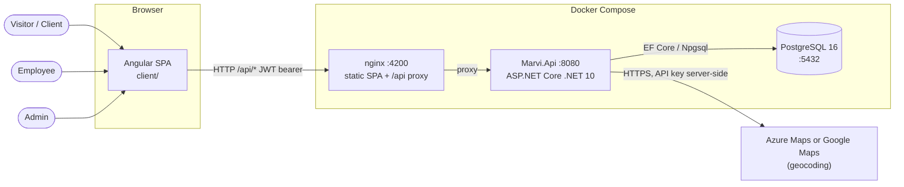

## 3. Repository map

```
Marvi.slnx
global.json                   .NET SDK 10.0.100 (rollForward latestMinor)
goal.md · project.md · architecture.md · README.md
docs/archive/                 superseded plan documents (history only; do not treat as spec)
src/
  Marvi.Api/                  HTTP host
    Program.cs                composition root only
    Features/<Feature>/       *Controller.cs, Contracts/ (one record per file), <Feature>Module.cs
  Marvi.Domain/<Feature>/     entities, enums, pure business services
  Marvi.Infrastructure/
    Data/                     AppDbContext, ApplicationUser
    Geocoding/                IGeocodingProvider (returns a GeocodeOutcome: Found, NotFound or Unavailable) + HttpGeocodingProvider base + Azure/Google adapters
    DependencyInjection/      AddInfrastructure(...)
    Migrations/               EF Core migrations
  Marvi.Shared/               empty placeholder (candidate for removal)
test/Marvi.Tests/<Feature>/   unit + integration tests; Support/ holds MarviApiFactory, fakes
test/runtime/                 data + security runtime test against the real stack (`bash test/runtime/run.sh`)
client/src/app/               core/ · shared/ · features/<feature>/
deploy/                       Dockerfile.api, Dockerfile.client, nginx.conf, docker-compose.yml
```

## 4. Backend

### 4.1 Layers and project references

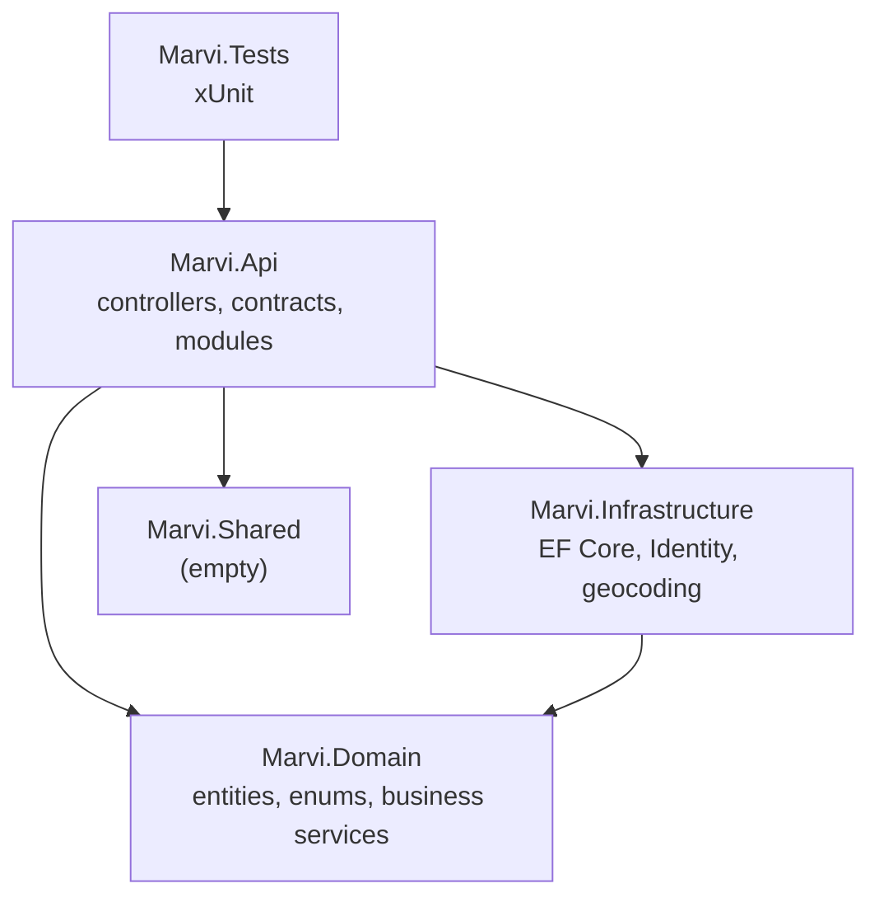

### 4.2 Feature map

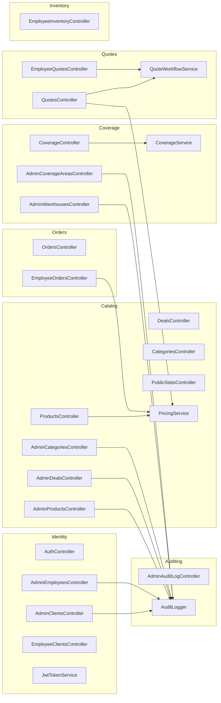

Cross-feature coupling that exists today (keep it minimal): Orders and Quotes call `PricingService`;
`QuoteWorkflowService.AcceptQuote` creates an `Order`; admin controllers in Identity/Catalog/Coverage
use `AuditLogger`; all features share `AppDbContext`.

### 4.3 Composition (`Program.cs`)

1. `AddControllers`, `AddOpenApi`, `AddInfrastructure(config)`.
2. One call per feature module: `AddIdentityFeature(config)` (JWT bearer validation, authorization,
   `JwtTokenService`, role seeding helper), `AddCatalogFeature` (`PricingService`),
   `AddCoverageFeature` (`CoverageService`), `AddQuotesFeature` (`QuoteWorkflowService`),
   `AddAuditingFeature` (`AuditLogger`, `IHttpContextAccessor`). Controllers are discovered by
   convention, so they need no registration.
3. CORS policy `SpaClient` (origin `Cors:AllowedOrigin`, default `http://localhost:4200`).
4. Pipeline: exception handler → forwarded headers (only when `ForwardedHeaders:Enabled`) → HTTPS redirection → CORS → rate limiter → authentication → authorization → controllers. Before everything, `ProductionConfigurationGuard.EnsureSafe` (MRV-3.3a) refuses to start in Production on example/weak secrets unless `Deployment:AllowExampleSecrets=true` (set only in the dev/runtime compose file). `Configuration/RateLimiting.cs` (MRV-3.3b) defines the `auth` (register/login, 10 per 60 s), `coverage` (public check, 30 per 60 s) and `contact` (public contact form, MRV-2.8, 5 per 60 s) per-client fixed-window policies, configurable under `RateLimiting:*`; 429 with `Retry-After`. Operations guidance lives in `docs/operations.md`.
5. Outside the `Testing` environment on startup: apply migrations, `IdentityModule.SeedRolesAsync` (creates `Client`,
   `Employee`, `Admin`), `IdentityModule.SeedAdminAsync` (first admin from config), and
   `DefaultPricingTier.GetOrCreateAsync` (ensures one default tier, "Standard"). `DefaultPricingTier` (Api/Features/Catalog, MRV-4.9) is the single owner of the default-tier rule: find (alphabetical fallback for legacy data), get-or-create and promote, `ShouldBeDefaultAsync` (the first tier ever is the default) and `MakeDefaultAsync` (un-flag and flush the old default, then flag the new one) and `ApplyRequestedDefaultAsync` (the update rules: the only default cannot be unset, asking for the default switches it); startup, registration, the catalog and the pricing-tier admin controller all use it. Tests run the same seeding via `MarviApiFactory`.

`AddInfrastructure` registers `AppDbContext` (Npgsql, snake_case naming), ASP.NET Core Identity
(`ApplicationUser`, `IdentityRole<Guid>`), a singleton `HttpClient` (a plain one, not from the HTTP client factory, so no request URL, which carries the geocoding key, is ever logged by HttpClient itself), and the `IGeocodingProvider`
chosen by `Geocoding:Provider` (`Google`, otherwise Azure Maps).
Geocoding returns a `GeocodeOutcome` (MRV-4.8): `Found`, `NotFound` (the provider does not know the address) or `Unavailable` (no or refused key, quota, outage, unreadable answer, logged as a warning, never with the key). The coverage check still answers visitors "not covered" for both non-found outcomes; a distinct message is an owner decision. Adapters share `HttpGeocodingProvider` and only supply the key setting, the URL and the answer parsing; they are tested with a stubbed `HttpMessageHandler` (no keys, no network). Google can answer HTTP 200 with a `status` such as `REQUEST_DENIED`, which is the provider failing, not an unknown address.

Contact (MRV-2.8a): `Features/Contact` holds the site's contact form. `PublicContactController` (`POST /api/public/contact`, anonymous, `[EnableRateLimiting("contact")]`) validates with `ContactRules` (trim, required, e-mail format, lengths; field-only problem messages, the visitor's text is never echoed or logged), drops a request whose honeypot field `website` is filled (204, nothing stored) and stores a `ContactMessage` (Domain `Contact`; table `contact_messages`, migration `ContactMessages`). `AdminContactMessagesController` (`/api/admin/contact-messages`, Admin) lists newest first with the shared `Paging`/`PagedResult` and an optional `handled` filter, and `POST .../{id}/handle` sets `HandledAt` through `AuditLogger.TrySaveAsync`; `HandledAt` is a concurrency token so a double-handle race is a 409. The admin inbox (`AdminPendingActionsController`) shows the unhandled ones as its `contactMessages` group. The feature has no services of its own (`AddContactFeature` is an empty registration kept for the one-line-per-feature convention).

Reviews (MRV-2.5): `Features/Reviews` serves `GET /api/public/reviews` from `ReviewsService`, which wraps `IPlaceReviewsProvider` (`Infrastructure/Reviews/GooglePlacesReviewsProvider`, Places API (New), key in a header) with an in-memory cache (60 min, failures 5 min) and 204 when there is nothing to show. The home page's `app-google-reviews` hides itself on 204 or failure.

### 4.4 Business services (domain)

| Service | Responsibility |
|---|---|
| `BasketPricingService` (MRV-4.3) | The one way to price a Basket (CONTEXT.md): `Validate(lines)` (non-empty, quantity >= 1), `Price(lines, PricingData)` and `PriceLine(...)`. Returns each line in request order as `PricedBasketLine` (`Product` null = unknown product, `UnitPrice` null = no price for the tier; never 0). Quotes, employee orders and the public catalog all price through it; `PricingDataLoader` (Api) loads the data. Deals are filtered with the single definition `Deal.ActiveAt(now)` |
| `PricingService.ResolvePrice(product, tier, pricingRows, activeDeals, qty)` | Tier unit price by quantity break (rows unique per product + tier + `MinQty`), then best active deal → `PricingResult`; throws `InvalidOperationException` when the tier has no price for the product |
| `CoverageService.CheckCoverage(lat, lng, warehouses)` (MRV-4.9) | Callers pass warehouses with their areas and do not filter: the service evaluates Radius areas by haversine distance and skips Polygon areas (not supported until Release 2: they never cover and never break the check). The older `CheckCoverage(lat, lng, (warehouse, area) pairs)` still throws `NotSupportedException` for a Polygon pair |
| `QuoteWorkflowService` | `CreateQuote`, `PriceQuote` (Submitted → Priced; every line needs a non-negative final price; employee id nullable for admins), `AcceptQuote` (Priced → Accepted, returns the new `Order` built by `OrderFactory`; a line without a final price throws `QuoteNotFullyPricedException` -> 409), `RejectQuote` (Priced -> Rejected, MRV-1.4: the customer turns a priced quote down and it can no longer be accepted); other invalid transitions throw `InvalidOperationException` |
| `OrderFactory.Place(customer, lines, ...)` (MRV-4.3) | The one place an `Order` is built from priced lines (ids, line items, `PlacedAt` = now in UTC (MRV-1.2b), `TotalAmount` = sum of unit price x qty); used by `AcceptQuote` and employee orders. The API shape of an order is built in one place, `OrderDto.From` |
| `ProductCsv` / `ProductImportPlanner` / `ProductRules` (MRV-2.1, `Domain/Catalog`) | The CSV product import as pure rules: `ProductCsv.Read` parses the file (comma or semicolon, quotes, BOM); `ProductImportPlanner.Plan(csv, ImportCatalog)` checks every header and row against the schema and the existing category/tier names and returns either every error with its line or the rows ready to store (a null value = blank cell = leave unchanged). `AdminProductImportController` (`POST /api/admin/products/import`) loads the names, applies a valid plan in one save with one `Import` audit entry, and supports `dryRun`; `ProductRules` holds the SKU/name limits it shares with the admin product form |
| `AdminPendingActionsController` (MRV-6.2, `Api/Features/Admin`) | The admin inbox: `GET /api/admin/pending-actions` reads its groups straight from `AppDbContext` (Pending customers, Submitted quotes, stock records at or below their reorder point, active products with no price in the default tier, active products with no stock record and, from MRV-2.8a, unhandled contact messages, newest first), each with a total count and at most 50 items, plus a grand total. The reorder rule is defined once in Domain, as an expression (`StockAvailability.NeedsReorderFilter`) that `NeedsReorder` evaluates in memory and the controller hands to the database; a product is unpriced when it has no default-tier price from quantity 1, and unstocked when it has no stock record at all |
| `StockAvailability` (MRV-4.10) | The one definition of stock availability: a product's available units are `QtyOnHand - QtyReserved` summed over its inventory records (one per warehouse), in stock when above zero. `Available(records)`, `InStock(records)`, `AvailableByProduct(records)`. The public catalog list loads only the stock records of the products it returns and the detail loads one product's; neither computes the sum itself. Reserving stock on orders is not built yet (Release 2), so `QtyReserved` is only ever set by hand today |

### 4.5 State machines

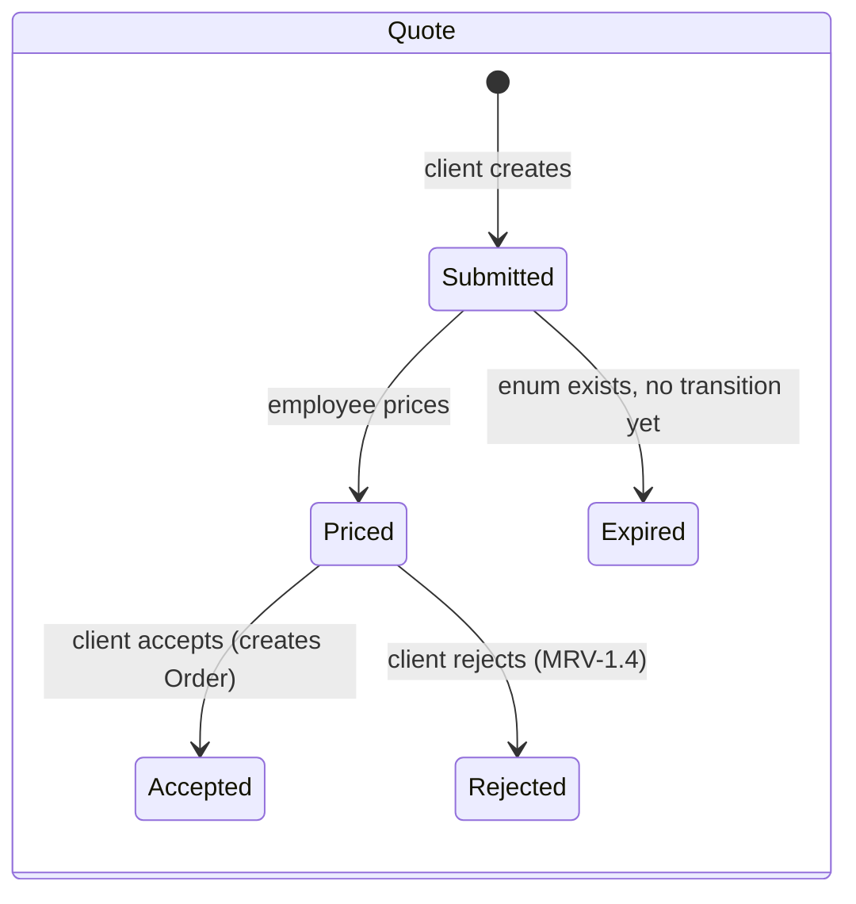

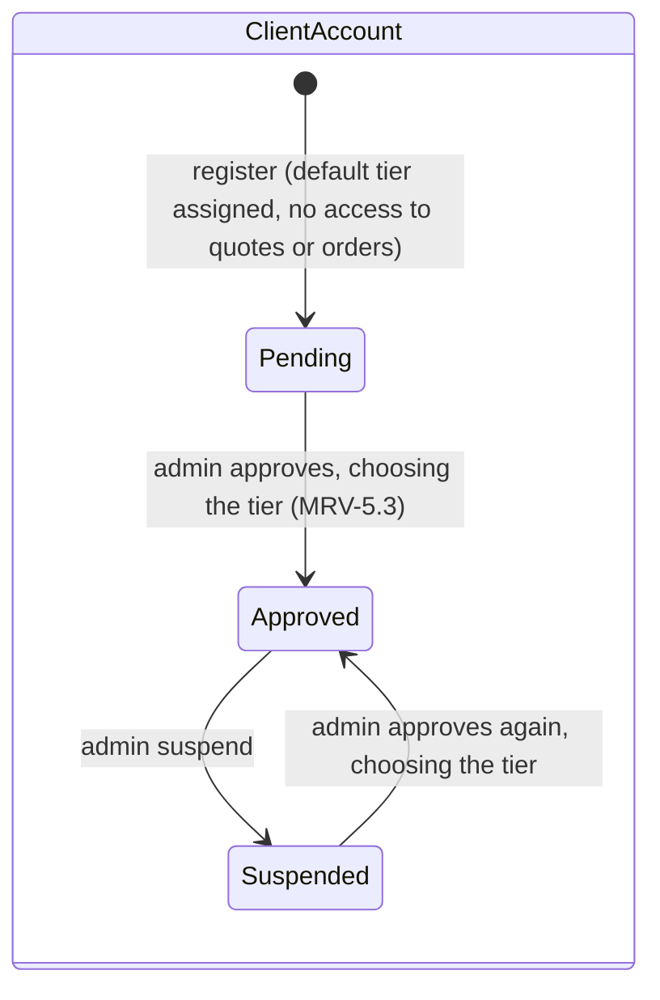

`OrderStatus` values: `Placed`, `Backordered`, `Fulfilled`, `Cancelled`. `QuoteStatus` also has `Draft`
(unused by current flows). Orders are created as `Placed`.

## 5. Data model

Tables are snake_case plurals via `UseSnakeCaseNamingConvention()`. `Product.Attributes`,
`AuditLogEntry.Details` (string dictionaries) and `CoverageArea.PolygonGeoJson` use `jsonb`.

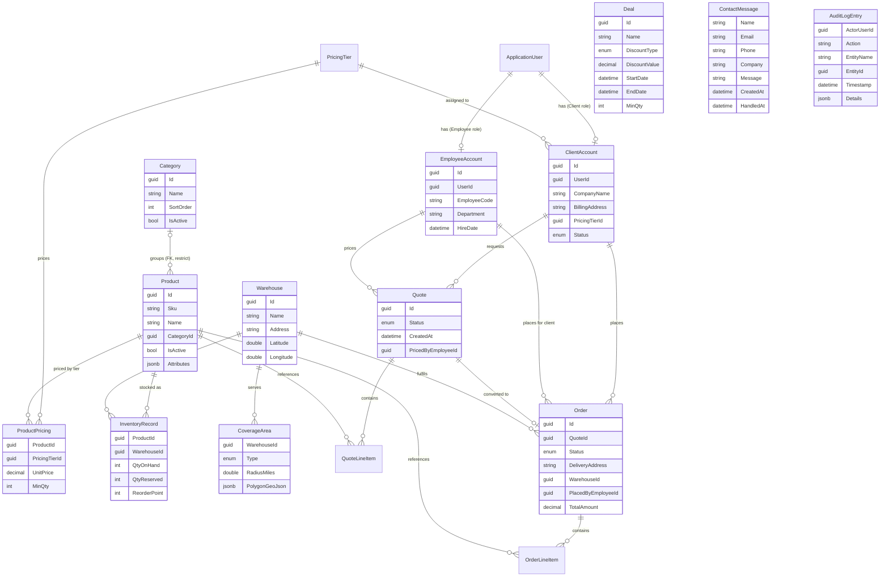

`Product.CategoryId` is a real foreign key to `Category` (restrict delete; nullable). Not drawn as
relationships because they are plain id lists: `Deal.ProductIds` and `Deal.CategoryIds` (no foreign key, so
`AdminCategoriesController` checks deals itself before deleting). `ClientAccount.ShippingAddresses`
is a string list column. `AuditLogEntry.ActorUserId` is not a foreign key. `ContactMessage` (MRV-2.8) stands alone: no relationships; `HandledAt` is a concurrency token.

## 6. Authentication and authorization

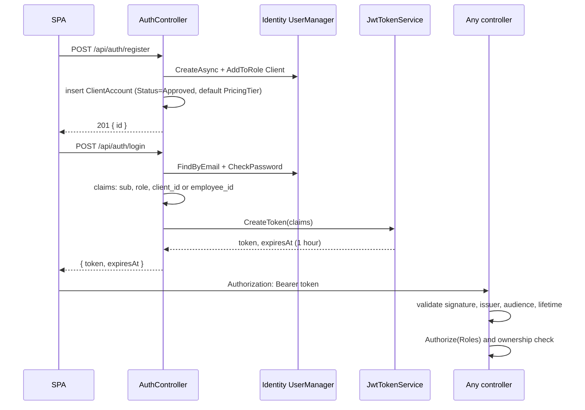

- Roles: `Client`, `Employee`, `Admin`. Only `POST /api/admin/employees` creates an Employee user.
- Claims: `sub` (user id), role (issued under the long URI `http://schemas.microsoft.com/ws/2008/06/identity/claims/role`, which the SPA reads), and `client_id` or `employee_id`. **`Identity/Principal.cs` (MRV-4.7) is the only place they are named, issued (`IssueClaims`) and read** (`User.ClientId()`, `User.EmployeeId()`, `User.UserId()`, `User.CanActAsStaff(out employeeId)`). Never call `User.FindFirst("client_id")` or parse claims in a controller. A Client token whose account record is missing carries no `client_id`, so every client endpoint answers 403.
- The role claim key is the long URI `http://schemas.microsoft.com/ws/2008/06/identity/claims/role`
  (`ClaimTypes.Role` on .NET 10; older frameworks used `xmlsoap.org/2005/...`), not `"role"`. The SPA's `AuthService` decodes it; any new JWT consumer must too.
  The SPA once used the old URI, so `role()` was always null and every portal bounced the user home; `auth.service.spec.ts` now pins a payload copied from a real login.
- Settings: `Jwt:Key`, `Jwt:Issuer` (`Marvi.Api`), `Jwt:Audience` (`Marvi.Client`). No refresh tokens.
- `ClientAccountStatus`: registration yields `Pending` (least privilege, MRV-5.3): nobody is approved by default, and "Aprovar" always needs an explicit pricing tier. **Customer eligibility** (`Marvi.Domain.Identity.CustomerEligibility`, MRV-4.2) is the single rule for who may transact: only `Approved` customers may request a quote, accept one, or have an order placed for them; `Pending` and `Suspended` get 403. `QuotesController` and `EmployeeOrdersController` both call it; do not compare the status directly. **Decisions are taken once** (`CustomerDecisions`, MRV-6.1): Pending or Suspended can be approved, Pending or Approved can be suspended, anything else is a 409 "already decided"; `ClientAccount.Status` is an EF concurrency token and `AuditLogger.TrySaveAsync` answers false (so 409) on a `DbUpdateConcurrencyException`; the customer's own profile save (which is not an audited admin mutation) reloads the row and retries, answering 409 only if it still collides, so two admins deciding at once cannot overwrite each other (on Postgres the losing save rolls back, audit entry included). There is no credit anywhere (MRV-5.1): customers pay directly. A customer edits their own company name, billing address and shipping addresses through `GET/PUT /api/client/profile` (MRV-2.2); `ClientProfileRules` (Domain/Identity) is the one definition of what those may be, used by registration and by the profile, and the account always comes from the token. An admin moves a customer to another pricing tier with `PUT /api/admin/clients/{id}/pricing-tier` (MRV-1.3, MRV-5.1): the status is untouched and the change is audited with the previous tier. Only an `Approved` customer gets their own tier's prices from the public catalog; anonymous visitors, `Pending` and `Suspended` customers get the default tier.
- **Admins have no employee account**, so no `employee_id` claim. Employee-area endpoints accept Admin and record a null employee (`Quote.PricedByEmployeeId`, `Order.PlacedByEmployeeId`).
- **First admin:** created at startup from `Seed:AdminEmail` / `Seed:AdminPassword` (dev values in `appsettings.Development.json` and `deploy/docker-compose.yml`; set your own elsewhere). Without them no Admin exists.

## 7. Key flows

### 7.1 Catalog pricing

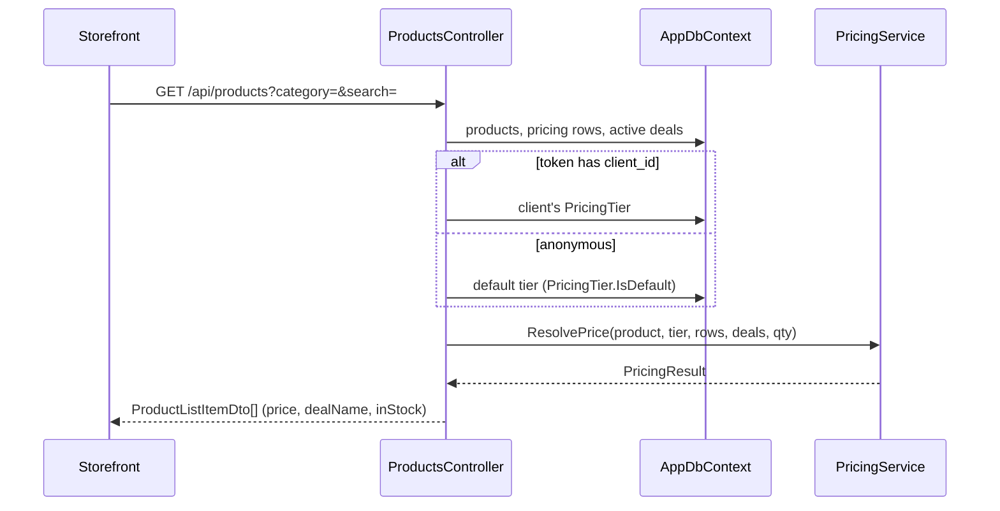

### 7.2 Coverage check

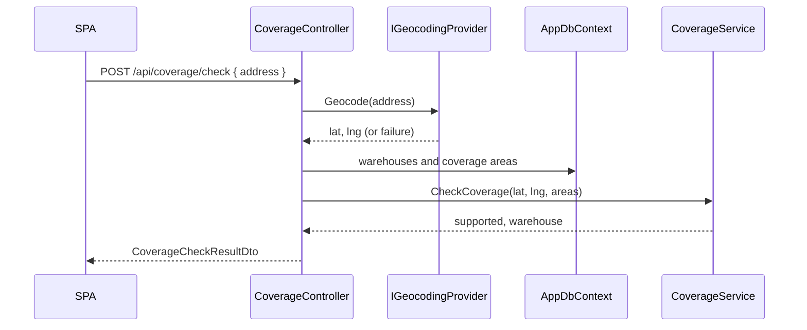

### 7.3 Quote to order

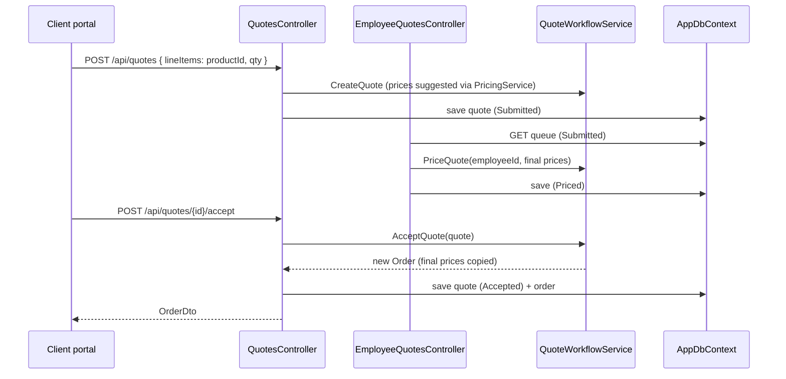

### 7.4 Employee order and admin audit

`EmployeeOrdersController.Create` loads the client, requires Customer eligibility (`Approved`), prices each line with
`BasketPricingService` using that client's tier, builds the `Order` through `OrderFactory.Place` (also used by `AcceptQuote`, so a total is always the sum of its lines) with `PlacedByEmployeeId`, and saves it. `AcceptQuote` refuses a quote that has a line without a final price (`QuoteNotFullyPricedException`, 409): a missing price is never a free order.
Admin controllers commit through `AuditLogger.TrySaveAsync(action, entityName, entityId, details)` (one save of the change and its audit entry; false on a constraint rejection, answered with 409),
which writes an `AuditLogEntry` with the actor taken from the JWT `sub` claim.

## 8. Frontend (`client/`)

Angular (standalone components, signals, functional guards/interceptors), SCSS, Vitest.
Angular project name: `marvi-client`; build output `dist/marvi-client/browser`.

```
src/app/
  app.ts · app.html (<router-outlet />) · app.config.ts · app.routes.ts
  core/auth/                AuthService, jwt.interceptor.ts, role.guard.ts
  core/http/                loadable, action, describeApiError (loading and error state, see below)
  core/catalog/             CatalogService: the public product list (search, category) and categories, shared by every screen that picks products
  core/i18n/                pt-br.ts (all copy), identity-errors.ts
  shared/ui/                app-header, app-footer, load-state, error-alert, count-up (a number that counts up once when first seen; shows the real number from the start and with reduced motion), product-picker (search, filter and pick catalog products; used by the client quote basket and the employee order form)
  shared/crud/              admin-crud: `formFeedback()` (problem, "saved" notice, request in flight for an admin form) and `confirmedDelete()` (the two-step delete) used by the admin catalog, pricing and operations screens (MRV-2.4b.7)
  shared/format/            brl (R$ 1.234,50) and ptDate (dd/mm/aaaa hh:mm) pipes
  shared/models/            types used by more than one feature (quote, order, catalog)
  features/
    home/                   the public landing page (project.md section 10): hero, flow, live stats band, category tiles, closing banner; every data-driven area has static fallback copy  + api/ (public-stats)
    auth/login/             login page
    storefront/             public catalog (search and category filter kept in the URL: ?category=<id>&q=<text>), deals, delivery check  + api/ (deals, coverage); products and categories come from core/catalog
    client-portal/          pick products from the catalog into a quote, send it, see quotes and prices, accept or reject (reject asks for a confirming click), see orders, edit own company details (profile/, MRV-2.2)  + api/ (quotes, orders, profile)
    employee-portal/        price queued quotes, find a customer by company name (directory search, MRV-2.4b.1), quotes and orders history at `/employee/historico` (history/, MRV-2.4b.2), place an order for an approved customer, stock  + api/ (employee)
    admin-portal/           admin shell with sub-pages: **inbox "Pendências" (the landing page: customers awaiting approval with inline Aprovar/Suspender, quotes awaiting a price, stock at its reorder point, products with no price; the count shows on its tab; MRV-6.3)**, overview at /admin/visao-geral (people, deals, audit), catalog (categories, products), prices (pricing tiers, per-product tier prices with quantity breaks), operations (warehouses, coverage areas, stock), customers (directory search, pricing tier, suspend and approve with an explicit tier; MRV-2.4b.4, MRV-5.3), import (product CSV upload, dry run, error list; MRV-2.4b.5), audit (the paged audit log; MRV-2.4b.6)  + api/ (admin)
```

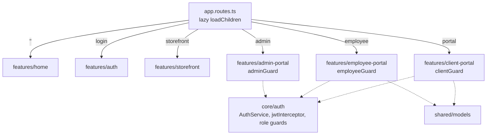

- Each feature owns a `<feature>.routes.ts`, its components and an `api/` folder of `HttpClient`
  services (relative URLs under `/api`). Cross-feature types go in `shared/models`.
- `jwtInterceptor` adds the bearer token and handles 401. Guards are `clientGuard`, `employeeGuard`
  (Employee or Admin) and `adminGuard`; the token is stored in `localStorage` as `marvi_auth_token`.
- Build with `npm run build`. Do not pass a ternary between `{key: v}` and `{}` as `HttpClient`
  `params` (wrong overload); build a `Record<string, string>` and assign conditionally (see
  `products.service.ts`).
- **Design system (MRV-2.3a):** tokens, element defaults and primitive classes (`.container .page .btn .card .field .alert .eyebrow` and, for data screens (MRV-2.4a), `.table .toolbar .stack .muted .badge .btn--small`) live
  in `src/styles/_tokens.scss`, `_base.scss`, `_components.scss`, loaded by `src/styles.scss`. Colors are CSS custom properties; change them only in `_tokens.scss`.
  Shared components are in `shared/ui` (`app-header`, `app-footer`), composed by the shell in `app.html` (skip link, header, `<main id="content">`, footer, floating WhatsApp button). Contact details (MRV-2.6) are one constant in `core/contact/contact-info.ts` (injectable as `CONTACT_INFO`); `contactLinks()` turns each into a `tel:`, `wa.me` or `mailto:` link, or null while it is still a placeholder. The privacy notice (MRV-2.7) is `shared/ui/privacy-notice`: `PrivacyNoticeState` holds visibility (dismissal in `localStorage` key `marvi.privacy-notice`, all access guarded) and the bar height the WhatsApp button stacks above; the policy is the lazy `features/privacy` route `/privacidade`.
- **Hero ribbons island (MRV-2.3d):** `client/island` is a separate npm package (React 18.3.1, esbuild; React 19 exceeded the 60 KB gzipped budget).
  `npm --prefix island run build` bundles `src/main.tsx` into `client/public/island/ribbons.js`, which defines the custom element `<marvi-ribbons>`
  and fails the build if the gzipped size exceeds 60 KB. The output and `island/node_modules` are git-ignored and docker-ignored; `deploy/Dockerfile.client`
  builds the island before the Angular build, so the script is served at `/island/ribbons.js`.
  `home.html` contains `<marvi-ribbons>` with the static SVG ribbons as its content. `features/home/hero-ribbons.loader.ts` injects the script
  (`type=module`) after the first render, when the browser is idle, and never rejects; it skips reduced-motion users. If the script is missing or fails, the static
  SVG stays. The animation pauses when off-screen or when the tab is hidden. To remove the island: delete `client/island`, the loader, the element in `home.html`
  and the two Dockerfile lines.
- **Session state:** `AuthService.isAuthenticated()` is a plain function (not a `computed`, which would never notice expiry) meaning an unexpired token that carries a known role; a stale or role-less token in storage is dropped at startup. The role guards require it, and `guestGuard` keeps signed-in users off `/login` and `/register` (registering again would silently replace their session).
  The skip link focuses `<main>` in code (a bare `#content` href would resolve against `<base href="/">` and leave the page).
- **Copy:** all user-facing text is in `core/i18n/pt-br.ts` (pt-BR only); templates read from `PT`, never hard-code strings. The API's English Identity errors are mapped to pt-BR in `core/i18n/identity-errors.ts`; unknown messages fall back to a generic one, so English never reaches the user.
- **Zoneless:** there is no `zone.js`. State that changes inside an async callback (HTTP, timers) **must be a signal**; assigning a plain field
  there does not re-render. Plain fields are fine only for `ngModel` bindings that are never written from a callback; form fields that are reset after an HTTP call are signals (`[(ngModel)]` binds to a writable signal). The storefront and the three portals were converted to signals on 2026-10-02 (they
  had never rendered API data); keep new screens on signals.
- **Landing page (MRV-2.3c):** sections are anchored (`#sobre` flow, `#por-que` stats band, `#rede` coverage stat, `#produtos`) and the header and footer link to them as `/#<id>`; the router has anchor scrolling enabled and the targets carry a scroll margin under the sticky header. The live numbers (`GET /api/public/stats`) and category tiles (`GET /api/categories`, up to six) are optional: while loading or when the API is down the same areas show static copy and no error is displayed on this public page. The hero ribbons are a static SVG; the animated version is the optional React island (MRV-2.3d). The `anyComponentStyle` budget in angular.json was raised to 8 kB warning / 12 kB error for the landing page styles.
- **Loading and errors (MRV-4.1):** never call `.subscribe` on an API request from a screen (the one exception is login and register, which own their credential-specific messages and busy state). Use `loadable(() => service.get(), initial)` (`core/http/loadable.ts`) for data a section shows (signals `data`, `loading`, `loaded`, `error`, plus `load()` to retry) and `action()` (`core/http/action.ts`) for things the user triggers (`busy`, `error`, `run(request, onSuccess)`). Render them with `<app-load-state [state] [emptyText]>` (loading, failure with retry, empty message) and `<app-error-alert [error]>` (action failures) from `shared/ui`. `describeApiError` (`core/http/api-error.ts`) maps the HTTP status (0, 400, 403, 404, 409, 5xx) to a pt-BR message and keeps the server's own text as secondary `detail`; the API has no error codes, so do not parse server text. Login treats only 400/401 as wrong credentials; register keeps the Identity translation for 400. Quote and order statuses (`PT.statuses`), client statuses and deal discount types are shown in pt-BR; the audit log keeps the API's technical action and entity names (it is a technical record).
- **Client tests:** vitest via `ng test`, specs beside the code; `core/auth/testing/fake-token.ts` builds a JWT for role-dependent tests. With Node < 22.22.3 run
  them in Docker (README).

## 9. Deployment

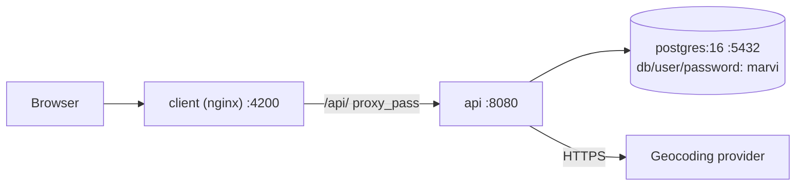

- `docker-compose.yml` builds `postgres`, `api` (`Dockerfile.api`: SDK build → ASP.NET runtime) and
  `client` (`Dockerfile.client`: Node build → nginx, config from `nginx.conf`).
- In compose the browser sees one origin, so CORS matters only for `ng serve` at :4200 against :5083.
- Secrets (`POSTGRES_PASSWORD`, `JWT_KEY`, `SEED_ADMIN_*`) come from untracked `deploy/.env`; copy `deploy/.env.example`. Compose fails fast if one is missing.
- To run the API from the IDE against the compose database, layer `deploy/docker-compose.dev-db.yml` (publishes Postgres on 127.0.0.1 only); see README.
- The Postgres password reaches the API as `PGPASSWORD`, not inside the connection string, so `;`, `=` or quotes in it are safe.
- Only the SPA (:4200) and API (:8080) are published; Postgres is reachable only inside the compose network. The API runs as the non-root `app` user and exposes `GET /health`; the `client` waits for it to be healthy.
- `.dockerignore` (root, for the API image) and `client/.dockerignore` keep host `bin/obj` and `node_modules` out of build contexts.
- `nginx.conf` sends the security headers and a Content-Security-Policy (MRV-3.3c); the Angular production build does not inline critical CSS, because its `onload` stylesheet swap is an inline handler the CSP forbids. TLS/HSTS are terminated in front of the containers (`docs/operations.md`).
- Migrations run automatically at API startup. The compose stack is verified end to end (MRV-3.1). Configuration (`Jwt:Key`, geocoding key, DB credentials) must be overridden for production.

## 10. Conventions

- **API contracts:** one `record` per file in `Features/<X>/Contracts`; `*Request` for inputs,
  `*Dto` for outputs (exception: `AuthResponse`). Namespace equals folder path.
- **Controllers:** `[ApiController]`, route `api/<area>/…`, constructor-injected `AppDbContext`
  and services. Admin routes live under `api/admin`, employee routes under `api/employee`.
- **Modules:** a feature that needs DI registrations exposes `Add<X>Feature(this IServiceCollection)`
  in `<X>Module.cs` and is called from `Program.cs`.
- **Domain:** C# `class` entities with public setters (EF Core), enums stored as defined; services
  are pure and unit-tested in `test/Marvi.Tests/<Feature>`.
- **Runtime tests:** `bash test/runtime/run.sh` uses its own compose project (`marvi-runtime`: separate containers, network and volume), so its `down -v` can never delete your dev database; it refuses to run if port 8080 is already in use. `test/runtime/api-security.mjs` seeds realistic data through the API and checks accuracy, every endpoint x every role, abuse inputs and database integrity on real Postgres (the in-memory provider cannot see foreign keys, indexes or cascades). Run it after any change to controllers, migrations or the model.
- **Tests:** integration tests use `MarviApiFactory` (EF InMemory + `FakeGeocodingProvider`,
  environment `Testing`, which skips migration/seed; the factory seeds roles itself).
- **Frontend:** standalone components, one `*.routes.ts` per feature, no business/price logic.
- **Formatting:** `.editorconfig` and Prettier in `client/`.

## 11. Gotchas and deliberate decisions

- **No repository layer.** `AppDbContext` is used directly by controllers; domain services stay pure. One deliberate helper: `PricingDataLoader` (Api/Features/Catalog) loads the products, tier prices and running Deals that `BasketPricingService` needs, because quotes and employee orders needed the identical load; it holds no rules and is not a repository for other data.
- **`Marvi.Api` shows `Microsoft.EntityFrameworkCore.Design` but gets EF Core APIs
  transitively** from `Marvi.Infrastructure`; do not remove that reference chain.
- **Polygon coverage is unimplemented** and throws; only `Radius` works.
- **Geocoding providers are untested against live keys** (their parsing and failure handling are tested with stubbed responses).
- **Orders do not touch inventory:** no reservation, decrement or stock check yet (Release 2); `Order.WarehouseId` and
  quote-to-order delivery address are not populated by the quote flow.
- **`Quote.Draft`/`Expired` and `Order.Backordered/Fulfilled/Cancelled`** exist as enum values with
  no workflow yet.
- **`Marvi.Shared` and `Marvi.Infrastructure/Class1.cs`** are empty template leftovers.
- **Enums go over the API as names** (`"Priced"`, `"Approved"`), via `[JsonConverter(typeof(JsonStringEnumConverter))]` on each exposed enum in the domain; the SPA models are string unions and the database still stores integers. A new exposed enum needs the attribute (`EnumContractTests`).
- **History is never deleted by a cascade.** Foreign keys from `order_line_items`/`quote_line_items` to products, from `orders`/`quotes` to client accounts and from `inventory_records` to warehouses are `Restrict`. `DELETE /api/admin/products/{id}` and `/warehouses/{id}` return 409 when history or stock exists (deactivate products instead); a warehouse's coverage areas do cascade. This was found when deleting a product silently removed its order lines and left order totals that no longer added up.
- **SKUs and category names are unique ignoring case** through hand-written expression indexes (`ix_products_sku_lower`, `ix_categories_name_lower`); the controllers pre-check and map the race to 409.
- **Input rules:** deals (0-100% or non-negative fixed, start < end, min qty >= 1), warehouses (lat/long ranges), coverage areas (real warehouse, radius 0-20000 mi), approvals (an existing tier chosen explicitly), products (SKU/name required and bounded) and emails (format) are validated and answered 400/409; nothing here should ever be a 500.
- **Dates are read as UTC** (`UtcDateTimeConverter`): a date without a time zone used to reach Npgsql as `Unspecified` and fail with a 500.
- **Bad text:** characters Postgres cannot store (NUL) become a 400 through `InvalidTextExceptionHandler`; `UseExceptionHandler` returns a generic 500 without internals for anything unexpected. The server header is removed.
- **Public landing data is counts and categories only** (MRV-2.3b): `GET /api/public/stats` returns product, category and radius-coverage-area counts (anonymous, `Cache-Control: public,max-age=60`, no prices or customer data); `GET /api/categories` is cached the same way. Polygon areas are not counted: the delivery check cannot serve them yet.
- **A product without a price has `price: null`** in the public catalog (the SPA shows "Sob consulta"); 0 would read as free. Only `NoPriceException` (a subtype of `InvalidOperationException`, thrown by `PricingService`) is turned into "no price" (a null `UnitPrice` on the `PricedBasketLine`), inside `BasketPricingService.PriceLine`; any other pricing failure must surface.
- **More input rules:** enum fields must be defined values; a Polygon area needs a JSON object and a Radius area never keeps polygon data; registration trims and bounds company name (200), address (500) and employee code (50). Dates without a time zone mean UTC, and a date-only value means midnight UTC, so the UI should send full timestamps for deal ends.
- **Audit paging** is validated (page/pageSize >= 1, pageSize capped at 200).
- **Known limitation:** deleting a category and creating a deal that targets it at the same instant can leave the deal with a dangling id (no foreign key on a list; the check is not atomic). Accepted for the admin-only volume; a join table would remove it.
- **Category names are capped at 200 characters** by the controller (keeps them under the btree index row limit).
- **Constraint races return 409, other database errors do not:** `DbUpdateException.IsConstraintViolation()` (Infrastructure) is true only for Postgres unique (23505) and foreign-key (23503) violations; controllers that pre-check and then save use it so a timeout is never reported as a duplicate.
- **A deal's `CategoryIds` are validated by `AdminDealsController`** (no foreign key on a list); products rely on the real foreign key plus a controller check.
- **Categories are deactivated, not deleted, once in use:** `DELETE /api/admin/categories/{id}` returns 409 while a product or deal references it. Category names are unique ignoring case: checked in the controller, and enforced by the hand-written expression index `ix_categories_name_lower` on `lower(name)` (migration `CaseInsensitiveCategoryNames`; EF cannot model it, so it is absent from the model and a duplicate race surfaces as 409 via `DbUpdateException`).
- **Default tier:** exactly one `PricingTier.IsDefault` (unique filtered index). Anonymous visitors and new clients use it; pre-flag data is self-healed by promoting the alphabetically first tier on startup/registration.
- **Missing price is not free:** quotes leave `SuggestedUnitPrice` null for unpriced products (the employee must set it); employee orders reject them with 400; accepting a quote whose line has no final price is refused with 409 (`QuoteNotFullyPricedException`) rather than creating a zero-price order.
- **There is no rate limiting** on any endpoint (planned in MRV-3.3).

## 12. How to add or remove a feature

**Add `Foo`:**
1. `src/Marvi.Domain/Foo/` — entities, enums, services; add `DbSet`s and mappings in `AppDbContext`; add a migration.
2. `src/Marvi.Api/Features/Foo/` — controllers, `Contracts/`, and `FooModule.cs` with `AddFooFeature`; call it in `Program.cs`.
3. `test/Marvi.Tests/Foo/` — service tests and integration tests via `MarviApiFactory`.
4. `client/src/app/features/foo/` — `foo.routes.ts`, components, `api/` services; add a lazy route in `app.routes.ts`; guard it if role-restricted.
5. Update this file (feature map, data model, flows) and `project.md` (status, API table).

**Remove `Foo`:** delete the four folders above, the `AddFooFeature` line and the lazy route, remove its
`DbSet`s and add a migration dropping its tables, then fix any cross-feature references listed in §4.2.
